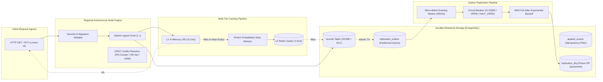
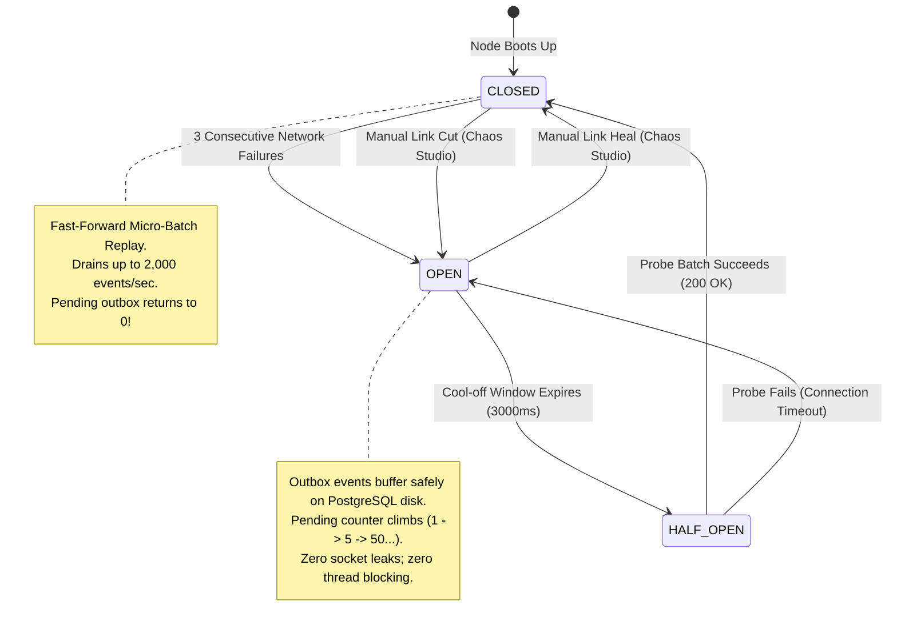
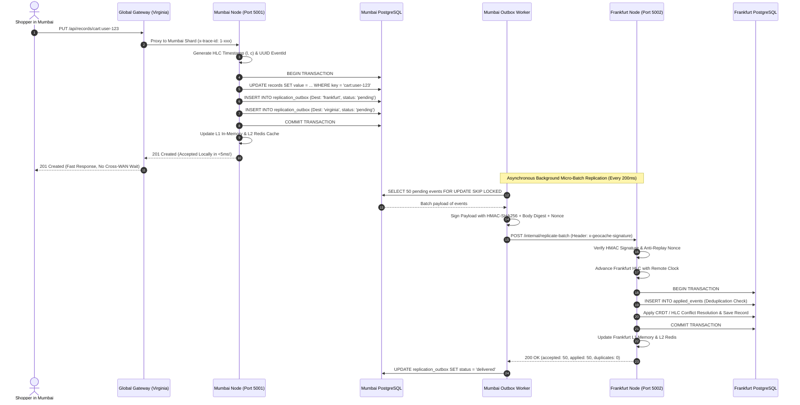

# Active-Active GeoCache — Architecture Diagrams

## 1. Global Multi-Region Topology

```mermaid
flowchart TD
    subgraph Clients["Global Ingress Layer"]
        C1["Customer Asia (Mumbai)"]
        C2["Customer Europe (Frankfurt)"]
        C3["Customer Americas (Virginia)"]
    end

    subgraph Router["Global Routing & Ingress"]
        DNS["Route 53 Latency-Based Router"]
        GW["Global Control Gateway & Proxy (Port 3000)"]
        RING["128-Vnode Consistent Hash Ring (SHA-256)"]
        DNS --> GW
        GW --> RING
    end

    C1 --> DNS
    C2 --> DNS
    C3 --> DNS

    subgraph Mumbai["Mumbai Region (ap-south-1) - Port 5001"]
        direction TB
        M_API["Regional API & HLC Engine"]
        M_L1["L1 In-Memory Cache (XFetch Stampede Guard)"]
        M_L2[("L2 Regional Redis Cluster")]
        M_PG[("PostgreSQL Store")]
        M_OUT["Transactional Outbox Queue"]
        M_CB["Link Circuit Breakers"]

        M_API --> M_L1
        M_L1 --> M_L2
        M_L2 --> M_PG
        M_PG --> M_OUT
        M_OUT --> M_CB
    end

    subgraph Frankfurt["Frankfurt Region (eu-central-1) - Port 5002"]
        direction TB
        F_API["Regional API & HLC Engine"]
        F_L1["L1 In-Memory Cache (XFetch Stampede Guard)"]
        F_L2[("L2 Regional Redis Cluster")]
        F_PG[("PostgreSQL Store")]
        F_OUT["Transactional Outbox Queue"]
        F_CB["Link Circuit Breakers"]

        F_API --> F_L1
        F_L1 --> F_L2
        F_L2 --> F_PG
        F_PG --> F_OUT
        F_OUT --> F_CB
    end

    subgraph Virginia["Virginia Region (us-east-1) - Port 5003"]
        direction TB
        V_API["Regional API & HLC Engine"]
        V_L1["L1 In-Memory Cache (XFetch Stampede Guard)"]
        V_L2[("L2 Regional Redis Cluster")]
        V_PG[("PostgreSQL Store")]
        V_OUT["Transactional Outbox Queue"]
        V_CB["Link Circuit Breakers"]

        V_API --> V_L1
        V_L1 --> V_L2
        V_L2 --> V_PG
        V_PG --> V_OUT
        V_OUT --> V_CB
    end

    RING -. Preference Routing .-> M_API
    RING -. Preference Routing .-> F_API
    RING -. Preference Routing .-> V_API

    M_CB <== "Mutual HMAC-SHA256 Micro-Batch Mesh" ==> F_CB
    F_CB <== "Mutual HMAC-SHA256 Micro-Batch Mesh" ==> V_CB
    M_CB <== "Mutual HMAC-SHA256 Micro-Batch Mesh" ==> V_CB
```

---

## 2. Regional Node Internal Subsystems

---

## 3. Circuit Breaker & Chaos Partition State Machine

---

## 4. End-to-End Write & Replication Data Flow

