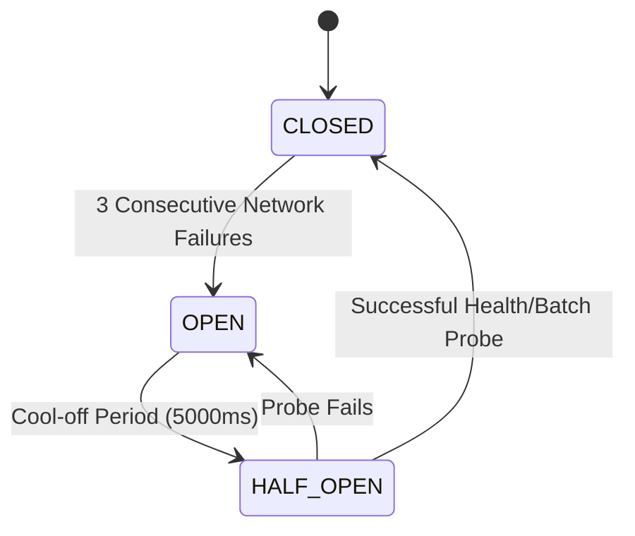
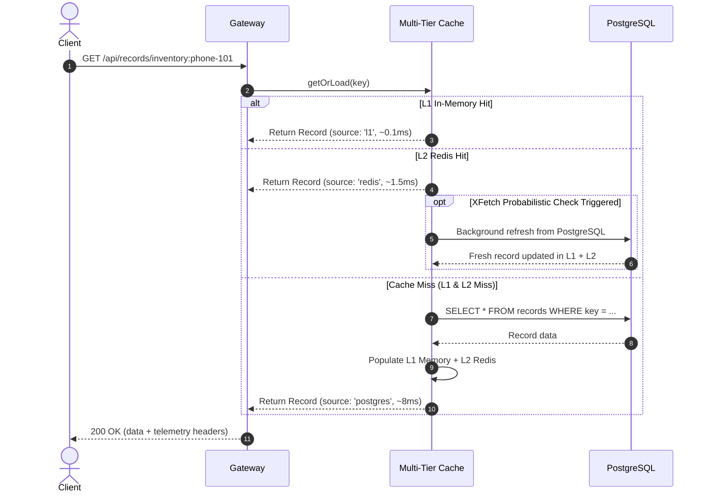
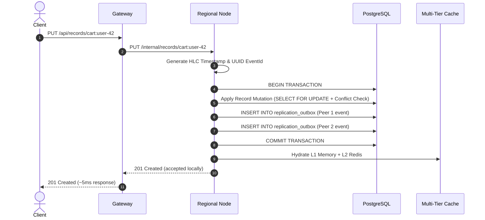
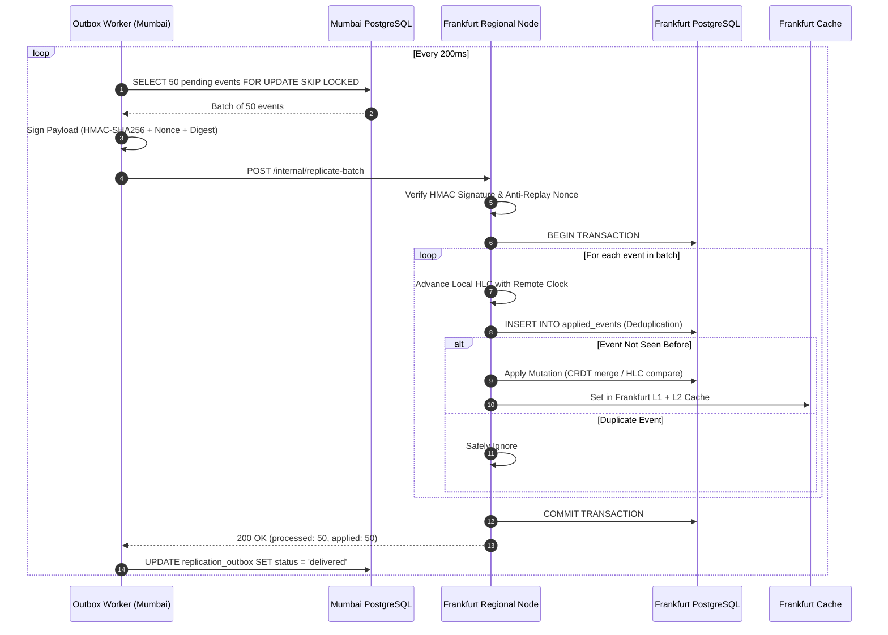

# GlobalCart GeoCache — System Design & Case Study Guide

> **An Enterprise-Grade, Active-Active, Multi-Region Distributed Cache and Data Replication Platform**  
> Spanning **Mumbai (`ap-south-1`)**, **Frankfurt (`eu-central-1`)**, and **Virginia (`us-east-1`)**.


---

## Table of Contents
1. [Executive Summary & Problem Statement](#1-executive-summary--problem-statement)
2. [The Case Study: GlobalCart Flash Sale](#2-the-case-study-globalcart-flash-sale)
3. [Core Distributed Systems Challenges & Theoretical Foundations](#3-core-distributed-systems-challenges--theoretical-foundations)
   - [The CAP & PACELC Theorems](#31-the-cap--pacelc-theorems-in-practice)
   - [Physical Clock Drift vs. Hybrid Logical Clocks (HLC)](#32-physical-clock-drift-vs-hybrid-logical-clocks-hlc)
   - [Cache Stampedes & The XFetch Algorithm](#33-cache-stampedes--the-xfetch-probabilistic-algorithm)
   - [Distributed Transactions vs. Transactional Outbox Pattern](#34-distributed-transactions-vs-transactional-outbox-pattern)
   - [Data Divergence & Conflict-Free Replicated Data Types (CRDTs)](#35-data-divergence--conflict-free-replicated-data-types-crdts)
   - [Replication Storms, Circuit Breakers & Dead-Letter Queues (DLQ)](#36-replication-storms-circuit-breakers--dead-letter-queues-dlq)
   - [Zero-Trust Inter-Region Security Mesh](#37-zero-trust-inter-region-security-mesh)
4. [System Architecture & Component Breakdown](#4-system-architecture--component-breakdown)
   - [High-Level Architecture Diagram](#41-high-level-architecture-diagram)
   - [Component 1: Global Ingress & Consistent Hash Ring](#42-component-1-global-ingress--consistent-hash-ring)
   - [Component 2: Multi-Tier Caching Hierarchy (L1 Memory + L2 Redis)](#43-component-2-multi-tier-caching-hierarchy-l1-memory--l2-redis)
   - [Component 3: Relational Persistence Layer (PostgreSQL)](#44-component-3-relational-persistence-layer-postgresql)
   - [Component 4: Resilient Micro-Batch Replication Queue Worker](#45-component-4-resilient-micro-batch-replication-queue-worker)
   - [Component 5: Conflict Resolution Engine](#46-component-5-conflict-resolution-engine)
   - [Component 6: CloudWatch EMF Observability & Distributed Tracing](#47-component-6-cloudwatch-emf-observability--distributed-tracing)
   - [Component 7: Regional Storefronts & Chaos Studio UI](#48-component-7-regional-storefronts--chaos-studio-ui)
5. [End-to-End Workflow Lifecycles (How Data Flows)](#5-end-to-end-workflow-lifecycles-how-data-flows)
   - [Lifecycle 1: Read Request (L1 -> L2 -> DB with XFetch)](#51-lifecycle-1-read-request)
   - [Lifecycle 2: Write Request (Atomic ACID Commit + Outbox Enqueue)](#52-lifecycle-2-write-request)
   - [Lifecycle 3: Asynchronous Cross-Region Replication](#53-lifecycle-3-asynchronous-cross-region-replication)
   - [Lifecycle 4: Network Partition & Self-Healing Fast Replay](#54-lifecycle-4-network-partition--self-healing-fast-replay)
6. [Database Schema & Data Model](#6-database-schema--data-model)
7. [Deployment & Verification Guide](#7-deployment--verification-guide)
   - [Local Docker Compose + Toxiproxy](#71-local-docker-compose--toxiproxy-chaos)
   - [Automated AWS Cloud Deployment](#72-automated-aws-cloud-deployment)
   - [Automated Test Suite (17 Tests)](#73-automated-test-suite)
   - [Chaos Benchmark](#74-chaos-benchmark)
8. [Summary Matrix of Algorithms & Decisions](#8-summary-matrix-of-algorithms--decisions)

---

## 1. Executive Summary & Problem Statement

Modern cloud applications serve millions of geographically dispersed users. Traditional database architectures rely on **single-primary (active-passive)** setups:
- Writes travel across intercontinental fiber to a single primary database (e.g., in US East).
- Users in Mumbai or Frankfurt suffer **180ms – 280ms WAN network latency** for every single cart click or write operation.
- If the primary region undergoes an outage, write operations freeze globally until manual or automated failover completes (often with data loss or downtime).

**GeoCache** solves this by implementing an **Active-Active, Multi-Region Architecture**:
- **Every region is an active, writable primary**: Mumbai, Frankfurt, and Virginia each run their own API node, PostgreSQL database, Redis cluster, and in-memory cache.
- **Zero cross-region latency on client requests**: Customers read and write to their geographically closest region with sub-millisecond local response times.
- **Asynchronous, durable bidirectional replication**: Local mutations are committed locally and replicated across regions in the background using a **Transactional Outbox**.
- **Mathematical convergence under network partitions**: If transatlantic cables are severed or AWS Availability Zones become isolated, each region remains 100% operational locally. When connectivity heals, data converges deterministically with mathematical consistency guarantees.

---

## 2. The Case Study: GlobalCart Flash Sale

To demonstrate this architecture under realistic, high-pressure conditions, the platform implements **GlobalCart**, a worldwide flash-sale e-commerce platform.

```
       🇮🇳 Mumbai Region            🇩🇪 Frankfurt Region          🇺🇸 Virginia Region
     [mumbai.html : 5001]        [frankfurt.html : 5002]       [virginia.html : 5003]
              |                            |                             |
     - Indian Rupee (₹)           - Euro (€)                    - US Dollar ($)
     - Local Customers            - Local Customers             - Local Customers
     - Flash Sale: Electronics    - Flash Sale: Fashion         - Flash Sale: Footwear
```

### Business Scenarios Handled:

1. **High-Concurrency Flash-Sale Inventory Reservations**:
   - A limited-edition smartphone has only 100 units worldwide.
   - Customers in Mumbai, Frankfurt, and Virginia buy units at the exact same second.
   - **Challenge**: Prevent overselling without forcing cross-region 2-Phase Commit (which would make checkouts stall for 250ms+ per user).
   - **Implementation**: Managed via **PN-Counter CRDTs** (Positive-Negative Counters) tracking regional increment and decrement vectors, allowing offline reservations that guarantee exact convergence when merged.

2. **Multi-Device / Cross-Region Shopping Cart Mutations**:
   - A traveler adds items to their shopping cart in Frankfurt airport, boards a flight, and checks out from Mumbai hotel WiFi.
   - Simultaneously, an automated promotional system or family member adds/removes items from the cart.
   - **Challenge**: Prevent concurrent additions from being overwritten or lost (the classic "lost update" anomaly).
   - **Implementation**: Solved via **OR-Set CRDTs** (Observed-Remove Set with Add-Wins semantics). Added elements receive unique cryptographic tokens so concurrent additions always survive deletions.

3. **High-Frequency Product Catalog Browsing**:
   - During a flash-sale drop, millions of shoppers refresh product pages simultaneously.
   - **Challenge**: Cache stampede (thundering herd) — when an item's TTL expires, thousands of concurrent requests miss the cache and hammer the database together, causing cascade failure.
   - **Implementation**: Solved using the **XFetch Probabilistic Early Expiration** algorithm in Node.js process memory (L1) and regional Redis (L2).

4. **Order Status Lifecycle Tracking**:
   - Order transitions follow a state machine: `created` $\to$ `payment_confirmed` $\to$ `shipped` $\to$ `delivered`.
   - **Challenge**: Clock skew across servers. If Frankfurt's server clock is 50ms behind Virginia's clock, an earlier status might appear newer and overwrite a newer status.
   - **Implementation**: Solved using **Hybrid Logical Clocks (HLC)** providing strict causal monotonic ordering across physical clock drifts.

---

## 3. Core Distributed Systems Challenges & Theoretical Foundations

### 3.1. The CAP & PACELC Theorems in Practice

According to the **CAP Theorem** (Brewer, 2000), a distributed data store can simultaneously guarantee at most two out of three properties:
- **C (Consistency)**: Every read receives the most recent write.
- **A (Availability)**: Every non-failing node returns a non-error response.
- **P (Partition Tolerance)**: The system continues to operate despite arbitrary message loss or network partitions.

Because physical networks are inherently subject to partitions ($P$), real-world distributed systems must choose between **CP** and **AP**.

**PACELC Extension** (Abadi, 2012):
> If there is a **P**artition, how does the system choose between **A**vailability and **C**onsistency?  
> **E**lse (under normal conditions), how does the system choose between **L**atency and **C**onsistency?

**GeoCache's Decision**: **PA/EL (High Availability & Low Latency)**
- **During Partitions ($P$)**: Prioritize **Availability ($A$)**. Local regions accept local writes and buffer replication events in the durable outbox.
- **During Normal Operation ($E$)**: Prioritize **Latency ($L$)**. Writes commit locally in $<5\text{ms}$ and replicate asynchronously, rather than blocking on cross-region synchronous consensus (like Raft or Paxos).

---

### 3.2. Physical Clock Drift vs. Hybrid Logical Clocks (HLC)

#### The Problem with Physical Time (`Date.now()` / NTP)
In cloud data centers (AWS EC2, GCP, Azure), server clocks drift due to temperature fluctuations, crystal oscillator imperfections, and virtual machine hypervisor pauses. NTP (Network Time Protocol) synchronizes clocks periodically, but clock drift between regions routinely ranges from **$5\text{ms}$ to $250\text{ms}$**, and leap seconds can even cause clocks to step backwards.

If system $A$ writes at physical time $t = 100$ and system $B$ writes at physical time $t = 90$ (due to clock skew), an e-commerce platform using physical timestamps would wrongly discard system $A$'s write or order updates backwards!

#### The HLC Solution (`lib/hlc.js`)
GeoCache implements the **Hybrid Logical Clock (HLC)** algorithm (Kulkarni et al., VLDB 2014). An HLC combines the best of physical time and Lamport logical clocks:

An HLC timestamp is a tuple:
$$(l, c)$$
Where:
- $l$: Highest physical time observed so far.
- $c$: Monotonically increasing logical counter for events occurring within the same physical millisecond.

```text
               Event Generation Rules:
               
   [Local Write Operation]                 [Remote Event Received (msg.l, msg.c)]
              |                                               |
  l' = max(l, physicalNow())                      l' = max(l, msg.l, physicalNow())
              |                                               |
  if l' == l:                                     if l' == l == msg.l:
      c = c + 1                                       c = max(c, msg.c) + 1
  else:                                           else if l' == l:
      c = 0                                           c = c + 1
                                                  else if l' == msg.l:
                                                      c = msg.c + 1
                                                  else:
                                                      c = 0
```

**Mathematical Guarantee**:  
If event $e_1$ causally precedes event $e_2$ ($e_1 \to e_2$), then:
$$HLC(e_1) < HLC(e_2) \quad \text{strictly}$$
Even if physical clocks drift by seconds, causal ordering is mathematically preserved without requiring specialized atomic clocks (like Google Spanner's TrueTime).

---

### 3.3. Cache Stampedes & The XFetch Probabilistic Algorithm

#### The Problem: The Thundering Herd
When a flash sale goes live for a hot product (e.g. `product:iphone-16`), thousands of requests read the cache per second. If the cache item has a TTL of 60 seconds, at second 61 the key expires.
In that exact millisecond:
- 5,000 concurrent requests find a cache miss.
- All 5,000 requests query PostgreSQL simultaneously.
- PostgreSQL CPU spikes to 100%, connections saturate, and the service crashes.

```text
Normal TTL:     [--- Valid Cache ---] -> [EXPIRED] -> 5,000 Requests Hammer DB!
```

#### The XFetch Solution (`lib/cache.js`)
GeoCache implements the optimal probabilistic early refresh algorithm (**XFetch**, Vattani et al., VLDB 2015):

A cache read evaluates:
$$\Delta \cdot \beta \cdot (-\ln(\text{rand}())) > (\text{expiry} - \text{now})$$

Where:
- $\Delta$: The measured computation/query time taken to fetch from PostgreSQL (in milliseconds).
- $\beta$: An aggressive early-refresh multiplier ($\beta \ge 1.0$).
- $\text{rand}()$: A uniform random float in $(0, 1]$.
- $(\text{expiry} - \text{now})$: Milliseconds remaining before hard expiration.

**Behavior**:
- When the item is fresh, $(\text{expiry} - \text{now})$ is large, so the probability of triggering early refresh is zero.
- As the item nears expiration, the probability continuously scales upward.
- Exactly **one** lucky concurrent request probabilistically wins the trigger, computes the fresh value in the background, and refreshes the cache *before* it ever expires!
- Result: **0% cache miss rate for hot keys under massive concurrency**.

---

### 3.4. Distributed Transactions vs. Transactional Outbox Pattern

#### Why Distributed 2-Phase Commit (2PC) Fails in Multi-Region
In a naive architecture, when a write occurs in Mumbai, Mumbai opens a 2PC transaction with Frankfurt and Virginia:
1. Mumbai sends `PREPARE` to Frankfurt and Virginia over the WAN.
2. Wait 150ms+ for network round-trips.
3. If Frankfurt is temporarily slow or partitioned, Mumbai's database row locks remain held indefinitely.
4. Client requests time out; system throughput collapses.

#### The Transactional Outbox Pattern (`db/schema.sql`, `services/region.js`)
GeoCache guarantees reliable cross-region delivery without 2PC using the **Transactional Outbox Pattern**:

```text
Local PostgreSQL Transaction:
┌────────────────────────────────────────────────────────┐
│ 1. UPDATE records SET value = ...                      │
│ 2. INSERT INTO replication_outbox (destination, event) │
└────────────────────────────────────────────────────────┘
                       ▲
                       │ ATOMIC COMMIT
                       ▼
Both the business mutation and replication events commit together or abort together.
```

- A database write can **never** succeed while losing its replication event.
- If the application crashes immediately after the write, the event is safe in PostgreSQL disk storage.
- A decoupled, high-performance background worker drains the outbox asynchronously.

---

### 3.5. Data Divergence & Conflict-Free Replicated Data Types (CRDTs)

When two regions write to the same key simultaneously during a network partition, the data diverges. GeoCache incorporates a pluggable **Conflict Resolution Engine (`lib/crdt.js`)**:

#### 1. PN-Counter (Positive-Negative Counter)
- **Use Case**: Flash-sale inventory stock reservation and replenish.
- **Data Structure**: Two vectors of counts indexed by region name: $P$ (increments) and $N$ (decrements).
- **Merge Operation (Least Upper Bound)**:
  $$P_{merged}[r] = \max(P_1[r], P_2[r]), \quad N_{merged}[r] = \max(N_1[r], N_2[r])$$
- **Counter Value**:
  $$V = \sum_{r} P[r] - \sum_{r} N[r]$$
- **Guarantee**: Commutative, associative, and idempotent ($A \sqcup B = B \sqcup A$, $(A \sqcup B) \sqcup C = A \sqcup (B \sqcup C)$, $A \sqcup A = A$). Regardless of message arrival order, all regions converge to the exact same inventory level!

#### 2. OR-Set (Observed-Remove Set with Add-Wins)
- **Use Case**: Shopping cart item additions and removals.
- **Problem with naive sets**: If Region A adds "Item 1" and Region B removes "Item 1" simultaneously, standard sets suffer merge anomalies.
- **OR-Set Semantics**:
  - Each added item is tagged with a unique cryptographic token: $(item, tag)$.
  - When an item is deleted, all currently observed tags for that item are placed into a `tombstones` set.
  - If an add and remove happen concurrently, the add creates a fresh tag that was not observed by the concurrent remove. Therefore, **the addition wins**. No customer purchases are accidentally lost!

#### 3. LWW-Register with HLC (Last-Write-Wins)
- **Use Case**: Customer profile updates, order shipping address changes.
- **Comparison Rule**: Compares the Hybrid Logical Clock tuple $(hlc\_time, hlc\_count, origin\_region)$.
- If times differ, higher time wins. If times match, higher logical count wins. If both match, deterministic tie-breaking by alphabetical region name ensures identical decisions across all nodes.

---

### 3.6. Replication Storms, Circuit Breakers & Dead-Letter Queues (DLQ)

#### The Circuit Breaker Pattern (`lib/queue.js`)
When an inter-region link fails (e.g., Frankfurt goes down), continuing to blast HTTP requests causes TCP socket exhaustion, connection leaks, and node starvation.
GeoCache equips every regional replication link with a **State-Machine Circuit Breaker**:



- **`CLOSED`**: Healthy operation. Micro-batches stream continuously.
- **`OPEN`**: The peer is known to be dead. The worker halts HTTP attempts completely and allows outbox events to accumulate safely on disk in PostgreSQL without burning CPU or sockets.
- **`HALF_OPEN`**: After a cool-off window, the worker sends a single test probe. If successful, the link transitions to `CLOSED` and initiates fast-forward batch replay.

#### AWS Full Jitter Exponential Backoff
When retrying failed replication requests, simple exponential backoff causes all retrying workers to synchronize and hit the recovering node at the exact same millisecond (a "retry storm").
GeoCache implements **AWS Full Jitter**:
$$\text{sleep} = \text{random}(0, \min(\text{cap}, \text{base} \cdot 2^{\text{retry\_count}}))$$
This distributes retry requests uniformly across time, smoothing load spikes.

#### Dead-Letter Queue (DLQ) & Poison Pill Isolation
If an outbox event contains malformed JSON or triggers an unhandled database error, retrying indefinitely causes **head-of-line blocking** — thousands of valid customer orders queue up behind one bad record.
- If an event exceeds **10 maximum retries**, GeoCache automatically moves the event to the `replication_dlq` table.
- The pipeline immediately moves on to process subsequent transactions.
- Operators can inspect `replication_dlq` via API or CloudWatch metrics.

---

### 3.7. Zero-Trust Inter-Region Security Mesh

Inter-region replication traffic travels over public WAN internet or cross-region VPC peering. GeoCache enforces **Zero-Trust Security (`lib/security.js`)**:

1. **HMAC-SHA256 Cryptographic Signature**:
   Every replication batch header includes:
   $$Signature = \text{HMAC-SHA256}(Timestamp + Nonce + BodyDigest, Secret)$$
2. **Body Digest Verification**:
   The HTTP body is hashed with SHA-256 (`x-signature-digest: sha256=...`). Any tampering by an adversary en-route invalidates the signature.
3. **Replay Attack Mitigation (Timestamp + Nonce)**:
   - Requests older than **300 seconds** are rejected immediately.
   - Every request includes a random UUID `x-signature-nonce`. Nonces are tracked in memory; duplicate nonces within the valid time window are rejected with `401 Unauthorized`.

---

## 4. System Architecture & Component Breakdown

### 4.1. High-Level Architecture Diagram

```
                                  Global Clients & Browsers
                                              |
                             Latency-Aware Geo Router / Gateway
                                              |
                   +--------------------------+--------------------------+
                   |                          |                          |
                   v                          v                          v
           Mumbai Region              Frankfurt Region            Virginia Region
            (ap-south-1)                (eu-central-1)               (us-east-1)
        +--------------------+      +--------------------+      +--------------------+
        |  Regional Gateway  |      |  Regional Gateway  |      |  Regional Gateway  |
        |  Consistent Ring   |      |  Consistent Ring   |      |  Consistent Ring   |
        +---------+----------+      +---------+----------+      +---------+----------+
                  |                           |                           |
        +---------v----------+      +---------v----------+      +---------v----------+
        | L1 In-Memory Cache |      | L1 In-Memory Cache |      | L1 In-Memory Cache |
        | (XFetch Stampede)  |      | (XFetch Stampede)  |      | (XFetch Stampede)  |
        +---------+----------+      +---------+----------+      +---------+----------+
                  |                           |                           |
        +---------v----------+      +---------v----------+      +---------v----------+
        | L2 Regional Redis  |      | L2 Regional Redis  |      | L2 Regional Redis  |
        | Cache-Aside Clust  |      | Cache-Aside Clust  |      | Cache-Aside Clust  |
        +---------+----------+      +---------+----------+      +---------+----------+
                  |                           |                           |
        +---------v----------+      +---------v----------+      +---------v----------+
        | PostgreSQL Store   |      | PostgreSQL Store   |      | PostgreSQL Store   |
        | - Records & HLC    |      | - Records & HLC    |      | - Records & HLC    |
        | - Outbox Queue     |      | - Outbox Queue     |      | - Outbox Queue     |
        | - DLQ Isolation    |      | - DLQ Isolation    |      | - DLQ Isolation    |
        +---------+----------+      +---------+----------+      +---------+----------+
                  |                           |                           |
        +---------v----------+      +---------v----------+      +---------v----------+
        | Outbox Queue Worker|      | Outbox Queue Worker|      | Outbox Queue Worker|
        | - Circuit Breaker  |      | - Circuit Breaker  |      | - Circuit Breaker  |
        | - Micro-Batching   |      | - Micro-Batching   |      | - Micro-Batching   |
        +---------+----------+      +---------+----------+      +---------+----------+
                  \___________________________ Asynchronous __________________________/
                                Mutual HMAC-SHA256 Replication Mesh
```

---

### 4.2. Component 1: Global Ingress & Consistent Hash Ring

- **File**: [`services/gateway.js`](file:///d:/Desktop/Code/Vidyalay%20ka%20karya/System%20Design/active-active-geocache/services/gateway.js), [`lib/hashRing.js`](file:///d:/Desktop/Code/Vidyalay%20ka%20karya/System%20Design/active-active-geocache/lib/hashRing.js)
- **Role**: Entry point for global clients and storefront browser sessions.
- **Key Capabilities**:
  - **Dynamic Sharding**: Uses consistent hashing on a $2^{32}-1$ integer ring. Each region owns **128 virtual nodes (vnodes)** hashed with SHA-256 for uniform key distribution.
  - **Preference List Routing**: For any key (e.g. `cart:user-123`), computes a deterministic preference list of nodes $[R_1, R_2, R_3]$.
  - **Health-Aware Failover**: Continuously probes regional health (`/health`) in the background every 1500ms. If the primary region is unavailable, smoothly routes to the next healthy replica on the preference list.
  - **Storefront Static Server**: Serves `mumbai.html`, `frankfurt.html`, `virginia.html`, and the global control dashboard.

---

### 4.3. Component 2: Multi-Tier Caching Hierarchy (L1 Memory + L2 Redis)

- **File**: [`lib/cache.js`](file:///d:/Desktop/Code/Vidyalay%20ka%20karya/System%20Design/active-active-geocache/lib/cache.js)
- **Role**: Blazing fast sub-millisecond data retrieval.
- **Layers**:
  - **L1 In-Memory LRU**: Resident in the Node.js process memory. Max 1,000 hot keys, micro-TTL of 10 seconds. Serves read requests in **$\approx 0.1\text{ms}$** with zero network I/O.
  - **L2 Regional Redis**: Local Redis 7 cluster. TTL of 3600 seconds. Serves read requests in **$\approx 1.5\text{ms}$**.
  - **XFetch Integration**: Seamlessly calculates probabilistic early refreshes, shielding PostgreSQL from stampedes.

---

### 4.4. Component 3: Relational Persistence Layer (PostgreSQL)

- **File**: [`db/schema.sql`](file:///d:/Desktop/Code/Vidyalay%20ka%20karya/System%20Design/active-active-geocache/db/schema.sql)
- **Role**: Durable, ACID-compliant source of truth for business data, outbox events, and deduplication records.
- **Tables**:
  - `records`: Current materialized business records with HLC timestamp, counter, version, origin region, and data type.
  - `replication_outbox`: Queue of pending events partitioned by destination region. Indexed by `(destination_region, status, next_attempt_at)` for lightning-fast retrieval.
  - `applied_events`: Processed UUID event deduplication table preventing replay anomalies.
  - `replication_dlq`: Dead-letter queue for poisoned or permanently failing events.

---

### 4.5. Component 4: Resilient Micro-Batch Replication Queue Worker

- **File**: [`lib/queue.js`](file:///d:/Desktop/Code/Vidyalay%20ka%20karya/System%20Design/active-active-geocache/lib/queue.js)
- **Role**: The replication engine that runs inside each regional node.
- **Key Capabilities**:
  - Drains pending outbox records every **200ms**.
  - Groups up to **50–100 events** into a single compressed HTTP payload sent to peer `/internal/replicate-batch`.
  - Atomically marks events as `delivered` upon receiving positive acknowledgement from the remote peer.
  - Manages link-level circuit breakers (`CLOSED` $\leftrightarrow$ `OPEN` $\leftrightarrow$ `HALF_OPEN`).
  - Implements AWS Full Jitter backoff on transient errors.

---

### 4.6. Component 5: Conflict Resolution Engine

- **File**: [`lib/crdt.js`](file:///d:/Desktop/Code/Vidyalay%20ka%20karya/System%20Design/active-active-geocache/lib/crdt.js)
- **Role**: Handles incoming replication payloads that collide with local writes.
- **Key Capabilities**:
  - Evaluates data type (`pn_counter`, `or_set`, or `lww`).
  - Merges PN-Counter states using least upper bound joins.
  - Merges OR-Sets using Add-Wins set union and tombstone checks.
  - Resolves LWW registers using Hybrid Logical Clock precedence.

---

### 4.7. Component 6: CloudWatch EMF Observability & Distributed Tracing

- **File**: [`lib/logger.js`](file:///d:/Desktop/Code/Vidyalay%20ka%20karya/System%20Design/active-active-geocache/lib/logger.js)
- **Role**: Enterprise-grade monitoring with zero-overhead metrics.
- **Key Capabilities**:
  - Emits **AWS Embedded Metric Format (EMF)** JSON logs directly to stdout. AWS CloudWatch automatically extracts high-resolution custom metrics:
    - `ReplicationLagMs` (p50, p95, p99 latency)
    - `QueueDepth` (backlog of pending replication events)
    - `CacheHitsL1`, `CacheHitsL2`, `CacheMisses`
    - `ConflictsResolved`
    - `DeadLetterCount`
  - Generates and propagates W3C / AWS X-Ray compatible distributed trace IDs (`x-trace-id`) across every client request, outbox entry, and batch replication HTTP call.

---

### 4.8. Component 7: Regional Storefronts & Chaos Studio UI

- **Files**: [`public/index.html`](file:///d:/Desktop/Code/Vidyalay%20ka%20karya/System%20Design/active-active-geocache/public/index.html), [`public/mumbai.html`](file:///d:/Desktop/Code/Vidyalay%20ka%20karya/System%20Design/active-active-geocache/public/mumbai.html), [`public/frankfurt.html`](file:///d:/Desktop/Code/Vidyalay%20ka%20karya/System%20Design/active-active-geocache/public/frankfurt.html), [`public/virginia.html`](file:///d:/Desktop/Code/Vidyalay%20ka%20karya/System%20Design/active-active-geocache/public/virginia.html)
- **Role**: User-facing shopping storefronts and interactive operator control center.
- **Key Capabilities**:
  - Full shopping cart and inventory simulation with live stock balances.
  - Interactive **Chaos Engineering Studio**: Allows operators to sever or degrade network links between regions in real-time with one click (via Toxiproxy).
  - Live topology map displaying node health, replication backlog depth, and circuit breaker status.

---

## 5. End-to-End Workflow Lifecycles (How Data Flows)

### 5.1. Lifecycle 1: Read Request



---

### 5.2. Lifecycle 2: Write Request (Atomic ACID Commit + Outbox Enqueue)



> **Key takeaway**: The client receives a fast 201 Created response in $\approx 5\text{ms}$. The client does **NOT** wait for peer regions across the ocean to acknowledge!

---

### 5.3. Lifecycle 3: Asynchronous Cross-Region Replication



---

### 5.4. Lifecycle 4: Network Partition & Self-Healing Fast Replay

Here is the exact progression during a simulated catastrophe (e.g. undersea cable cut between Mumbai and Frankfurt):

```text
[T = 0s]  Toxiproxy severs connection between Mumbai and Frankfurt.
[T = 1s]  Mumbai customers continue purchasing items.
          - Local writes commit in Mumbai PostgreSQL in <5ms.
          - Events for Frankfurt are written to replication_outbox with status='pending'.
[T = 2s]  Mumbai Outbox Worker attempts HTTP POST to Frankfurt. Connection times out.
[T = 4s]  After 3 consecutive failures, Mumbai's Circuit Breaker to Frankfurt trips to [OPEN].
          - Worker stops making HTTP attempts to Frankfurt.
          - No socket leaks, no thread blocking.
          - Events cleanly accumulate in PostgreSQL on disk (QueueDepth: 50 -> 200 -> 1000).
[T = 5s]  Frankfurt customers continue purchasing locally as well.
          - Frankfurt's outbox similarly buffers events destined for Mumbai.
[T = 30s] Partition heals! Operator restores link in Chaos Studio.
[T = 35s] Mumbai Circuit Breaker reaches cool-off period and transitions to [HALF_OPEN].
          - Sends a probe batch of 10 events.
          - Frankfurt acknowledges 200 OK.
          - Mumbai Circuit Breaker snaps to [CLOSED]!
[T = 36s] Fast-Forward Micro-Batch Replay triggers:
          - Drains at 2,000+ events/sec using 50-item batches.
          - Deduplication table filters any retransmitted packets.
          - CRDT engine merges concurrent edits without data loss.
          - Queue depth drops to 0. Both regions reach identical consistent state!
```

---

## 6. Database Schema & Data Model

The schema is defined in [`db/schema.sql`](file:///d:/Desktop/Code/Vidyalay%20ka%20karya/System%20Design/active-active-geocache/db/schema.sql):

```sql
-- 1. Durably stores the current state of business records
CREATE TABLE IF NOT EXISTS records (
  key TEXT PRIMARY KEY,
  value JSONB NOT NULL,
  data_type TEXT NOT NULL DEFAULT 'lww',       -- 'lww' | 'pn_counter' | 'or_set'
  hlc_time BIGINT NOT NULL DEFAULT 0,          -- Physical component of HLC
  hlc_count INTEGER NOT NULL DEFAULT 0,        -- Logical component of HLC
  version BIGINT NOT NULL DEFAULT 0,
  origin_region TEXT NOT NULL,
  updated_at TIMESTAMPTZ NOT NULL DEFAULT now()
);

-- 2. Durable transactional outbox for cross-region replication
CREATE TABLE IF NOT EXISTS replication_outbox (
  id BIGSERIAL PRIMARY KEY,
  event_id UUID NOT NULL,
  destination_region TEXT NOT NULL,
  key TEXT NOT NULL,
  value JSONB NOT NULL,
  data_type TEXT NOT NULL DEFAULT 'lww',
  hlc_time BIGINT NOT NULL DEFAULT 0,
  hlc_count INTEGER NOT NULL DEFAULT 0,
  version BIGINT NOT NULL DEFAULT 0,
  origin_region TEXT NOT NULL,
  status TEXT NOT NULL DEFAULT 'pending' 
    CHECK (status IN ('pending', 'delivered', 'dead_letter')),
  retry_count INTEGER NOT NULL DEFAULT 0,
  max_retries INTEGER NOT NULL DEFAULT 10,
  next_attempt_at TIMESTAMPTZ NOT NULL DEFAULT now(),
  last_error TEXT,
  trace_id TEXT,
  created_at TIMESTAMPTZ NOT NULL DEFAULT now(),
  delivered_at TIMESTAMPTZ,
  UNIQUE (event_id, destination_region)
);

-- 3. Dead-Letter Queue for poison pills
CREATE TABLE IF NOT EXISTS replication_dlq (
  id BIGSERIAL PRIMARY KEY,
  outbox_id BIGINT,
  event_id UUID NOT NULL,
  destination_region TEXT NOT NULL,
  key TEXT NOT NULL,
  payload JSONB NOT NULL,
  failure_reason TEXT NOT NULL,
  retry_count INTEGER NOT NULL,
  failed_at TIMESTAMPTZ NOT NULL DEFAULT now()
);

-- 4. Deduplication table for applied replication events
CREATE TABLE IF NOT EXISTS applied_events (
  event_id UUID PRIMARY KEY,
  origin_region TEXT NOT NULL,
  key TEXT,
  hlc_time BIGINT,
  applied_at TIMESTAMPTZ NOT NULL DEFAULT now()
);
```

---

## 7. Deployment & Verification Guide

### 7.1. Local Docker Compose + Toxiproxy Chaos

To run the complete system locally with simulated network latency and partition injection:

```powershell
# 1. Install dependencies
npm install

# 2. Spin up 3 Regions + Redis + Postgres + Toxiproxy + Gateway
docker compose up --build
```

**Access Points**:
- 🎛️ **Control Center & Chaos Studio**: [http://localhost:3100](http://localhost:3100)
- 🇮🇳 **Mumbai Storefront**: [http://localhost:3100/mumbai.html](http://localhost:3100/mumbai.html)
- 🇩🇪 **Frankfurt Storefront**: [http://localhost:3100/frankfurt.html](http://localhost:3100/frankfurt.html)
- 🇺🇸 **Virginia Storefront**: [http://localhost:3100/virginia.html](http://localhost:3100/virginia.html)

---

### 7.2. Automated AWS Cloud Deployment

The repository includes a 1-click deployer for AWS Academy / AWS Cloud:

```powershell
node scripts/deploy-aws-academy.js
```

**What it automatically executes**:
1. Verifies caller identity via AWS STS.
2. Discovers default VPC and creates `geocache-sg` security group (ports 22, 3000, 5001, 5002, 5003).
3. Bundles application source files into a gzipped package and uploads to S3.
4. Launches **3 EC2 Virtual Machines** across different Availability Zones (`us-east-1a`, `us-east-1b`, `us-east-1c`).
5. Executes cloud-init user-data to auto-install Node.js 22 LTS, Redis, and PostgreSQL.
6. Links the dynamic peer discovery mesh and starts production systemd services.
7. Outputs live public URLs ready for demo.

*(A complete step-by-step manual AWS guide is also provided in [`manual-deploy-playbook.md`](file:///C:/Users/dell/.gemini/antigravity/brain/7ecff275-fdbd-49b4-9101-cd082f3fc6a3/manual-deploy-playbook.md)).*

---

### 7.3. Automated Test Suite

Run the 17 integration and unit tests:

```powershell
npm test
```

| Test File | Verification Scope |
|---|---|
| `tests/hlc.test.js` | Monotonic ordering, logical counter increments, cross-region clock sync, physical clock skew resilience |
| `tests/hashRing.test.js` | Ring uniformity, SHA-256 vnode distribution, preference list stability under node failure |
| `tests/crdt.test.js` | PN-Counter join-semilattice properties, OR-Set Add-Wins semantics, LWW deterministic ties |
| `tests/replication.test.js` | End-to-end causality, circuit breaker state transitions, HMAC signature verification, nonce anti-replay, payload tampering detection |

---

### 7.4. Chaos Benchmark

To run an automated chaos injection and replay benchmark:

```powershell
npm run benchmark
```

1. Measures baseline latency.
2. Injects a hard network partition via Toxiproxy between Mumbai and Frankfurt.
3. Bombs partitioned Mumbai with **50 concurrent atomic writes**.
4. Verifies circuit breaker tripping to `OPEN` and outbox backlog accumulation.
5. Heals the network partition.
6. Measures fast-forward micro-batch replay throughput (events/sec) until queue depth reaches zero.

---

## 8. Summary Matrix of Algorithms & Decisions

| Subsystem | Algorithm / Pattern | Why Chosen | Alternative Considered & Rejected |
|---|---|---|---|
| **Data Partitioning** | Consistent Hash Ring with 128 SHA-256 Virtual Nodes | Uniform key distribution with minimal key remapping when nodes change | Modulo Hashing (causes massive re-shuffling on node additions) |
| **Causal Ordering** | Hybrid Logical Clocks (HLC) | Strict monotonic causality without relying on fragile NTP clock synchronization | Wall-clock `Date.now()` (causes lost updates due to physical clock skew) |
| **Inventory Stock** | PN-Counter CRDT | Allows concurrent offline reservations that mathematically converge without overselling | Strong 2PC Distributed Locking (too slow across WAN; stalls checkouts) |
| **Shopping Carts** | OR-Set with Add-Wins Semantics | Concurrent additions across devices/regions survive concurrent removals | Last-Write-Wins (wipes out items added from another device) |
| **Cache Stampede** | XFetch Probabilistic Early Expiration | Zero cache misses for hot items by refreshing probabilistically before TTL expires | Mutex Locking (causes thread contention and connection pooling starvation) |
| **Data Replication** | Transactional Outbox Pattern | Atomically couples business writes with replication events in a single local DB transaction | Dual-Writing to DB and Message Queue (risks phantom writes or lost events on crash) |
| **Replication Transport** | HTTP Micro-Batching (50 items/call) | Maximizes throughput and amortizes TCP/TLS handshake overhead | Single-event streaming (poor throughput; thousands of HTTP connections) |
| **Link Fault Tolerance** | State-Machine Circuit Breakers | Protects workers from socket exhaustion and thread stalls when a remote region is down | Infinite synchronous retry (causes cascading cluster crash) |
| **Retry Strategy** | AWS Full Jitter Exponential Backoff | Prevents synchronized thundering retry storms across recovering nodes | Fixed backoff or linear backoff (creates wave-like harmonic retry spikes) |
| **Security Mesh** | Mutual HMAC-SHA256 + Body Digest + Nonces | Authenticates origin, verifies payload integrity, and blocks replay attacks | Plain API keys (vulnerable to packet sniffing, tampering, and replay) |
| **Observability** | CloudWatch Embedded Metric Format (EMF) | Extracts real-time p50/p95/p99 metrics from stdout with zero network overhead | Synchronous metric push APIs (adds network latency and failure points) |

---

*Authored for the Active-Active GeoCache Multi-Region Distributed Systems Project.*
